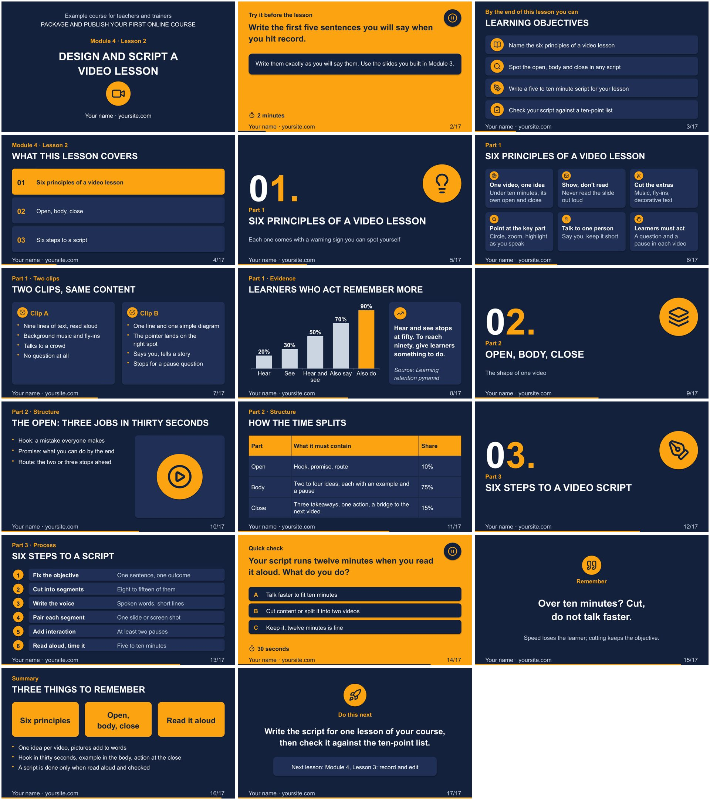
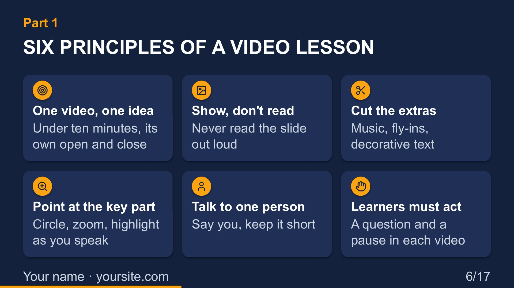
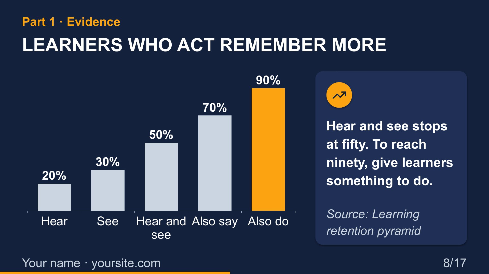
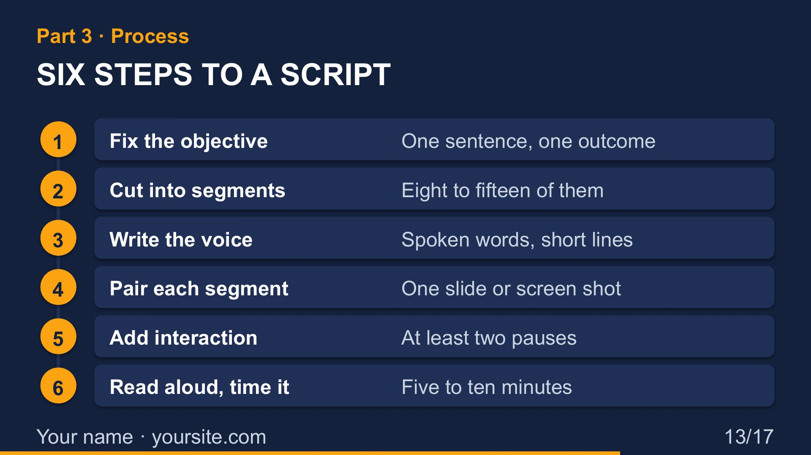
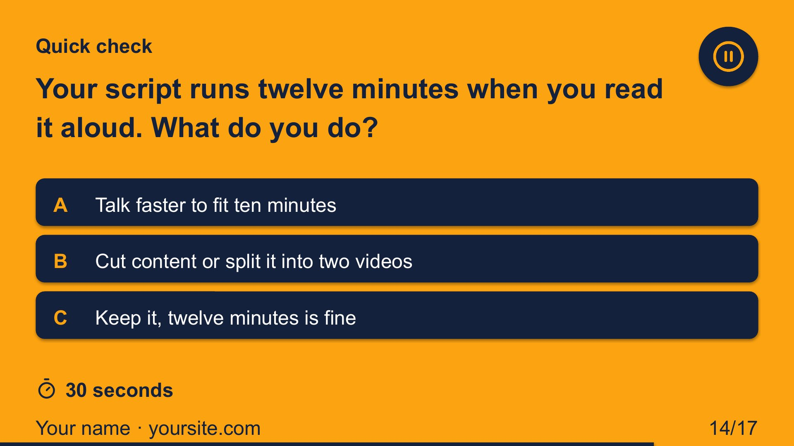

# Lesson Slide Designer: a Claude Skill that turns a lesson into a teaching slide deck (PowerPoint) and a video script

**Lesson Slide Designer is an open-source Agent Skill for Claude that turns one lesson (a lesson plan, a teaching script, a syllabus section or rough notes) into a 16:9 PowerPoint deck built on instructional design rules, with icons, native charts and the narration in the speaker notes, plus a slide-by-slide video script ready for a narrated slideshow video or a text-to-speech pipeline.**

You give Claude one lesson. Claude plans the deck, writes every slide as data, builds the `.pptx` with a Python script that refuses to break the rules (nothing under 24 pt, at most 6 lines, no orphan words, no clipped text, three colours, a visual on every slide), renders every slide to an image, looks at the result and fixes it before handing it over.

It works in Claude Code, the Claude desktop and web apps, and the Claude Agent SDK. For live classes, workshops, corporate training and self-paced video courses on Udemy, Teachable, Coursera, Thinkific or any LMS. Any language. MIT licensed.



It is the third skill in a set for course creators:
- [Curriculum Designer](https://github.com/chuonglife/curriculum-designer-skill) designs the whole program.
- [Lesson Content Writer](https://github.com/chuonglife/lesson-content-writer-skill) writes each lesson in full.
- **Lesson Slide Designer** turns each lesson into slides and a video script.

## Contents

- [What you get](#what-you-get)
- [Who it is for](#who-it-is-for)
- [Install](#install)
- [Use it](#use-it)
- [How the skill works](#how-the-skill-works)
- [The rules it enforces](#the-rules-it-enforces)
- [The 16 slide types](#the-16-slide-types)
- [Example output](#example-output)
- [FAQ](#faq)
- [Repository layout](#repository-layout)
- [Sources and credits](#sources-and-credits)

## What you get

One folder per lesson:

| File | What it is |
|---|---|
| `slides.json` | The single source of the deck: every slide as data. Edit it and rebuild, never style slides by hand |
| `<lesson>.pptx` | A 16:9 PowerPoint deck: Arial, a three-colour theme, Lucide icons, native editable charts and tables, a progress bar, the narration in each slide's speaker notes |
| `<lesson>.video-script.md` | The hand-over file for video: per slide, the on-screen text, production notes (reveals, circles, pauses), narration written for text-to-speech, and seconds; plus an overview table and a coverage table per video |
| `_preview/slide-NN.png` | Every slide rendered at 1920x1080, and a contact sheet, so Claude (and you) check the real result |
| `<lesson>.preview.mp4` | Optional: a slideshow video at the scripted timings, silent or with one audio file per slide |

A slide in `slides.json` looks like this:

```json
{
  "type": "process",
  "label": "Part 3 · Process",
  "title": "Six steps to a script",
  "steps": [
    {"title": "Fix the objective", "text": "One sentence, one outcome"},
    {"title": "Cut into segments", "text": "Eight to fifteen of them"},
    {"title": "Read aloud, time it", "text": "Five to ten minutes"}
  ],
  "narration": "Six steps.\nFix the objective in one sentence.\n...",
  "notes": "Reveal each step with its arrow as the narration reaches it."
}
```

## Who it is for

- **Teachers and lecturers** who want clean, readable lesson slides without fighting PowerPoint.
- **Online course creators** on Udemy, Teachable, Coursera, Kajabi or Thinkific who record slide-based video lectures and need slides and a narration script together.
- **Corporate trainers and L&D teams** building onboarding, product and compliance sessions.
- **Instructional designers** who want a first deck that already respects multimedia learning principles.
- **Vocational and technical (TVET) instructors**, coaches and workshop leaders.
- Anyone producing **AI-narrated slideshow videos** who needs narration that a text-to-speech engine reads well.

## Install

**Claude Code (personal, all projects)**

```bash
git clone https://github.com/chuonglife/lesson-slide-designer-skill ~/.claude/skills/lesson-slide-designer
pip install -r ~/.claude/skills/lesson-slide-designer/requirements.txt
```

**Claude Code (one project only)**

```bash
git clone https://github.com/chuonglife/lesson-slide-designer-skill .claude/skills/lesson-slide-designer
pip install -r .claude/skills/lesson-slide-designer/requirements.txt
```

**Claude desktop or web app**

Download `lesson-slide-designer.skill` from the [latest release](https://github.com/chuonglife/lesson-slide-designer-skill/releases/latest) and add it under Settings, Capabilities, Skills.

**Requirements**: Python 3.9+ with `python-pptx`, `Pillow`, `lxml` and `cairosvg` (installed by `requirements.txt`; `sharp-cli`, `rsvg-convert` or Inkscape also work for icons). To render the preview images: [LibreOffice](https://www.libreoffice.org/) and Poppler (`pdftoppm`). For the optional preview video: `ffmpeg`. Text is measured with Arial, or Liberation Sans on Linux.

## Use it

Ask in plain language. The skill triggers on requests for slides, a deck, a PowerPoint or a presentation for a lesson, class, workshop or course video.

```
Turn lessons/support-onboarding/M03-L02/02_Lesson_Content.md into slides.
Live class, our brand colours are close to the forest theme.
```

```
Make the PowerPoint for my Year 9 lesson on photosynthesis from these notes.
45 minutes, two pause questions, a summary slide.
```

```
This is the script of my Udemy lecture "Pricing your coaching packages".
Build the slides and the video script, one video per topic, 10 minutes max each.
```

```
Here is my lesson plan in Vietnamese. Make the slides in Vietnamese, plum theme.
```

To do a whole course, ask for one lesson at a time. The skill reuses the theme, the footer and the icon-per-concept set from the earlier lessons so the course looks like one piece.

## How the skill works

1. **Read the source and settle the brief.** Objectives, audience, delivery mode, the lesson plan with minutes, the script, the questions and answers, any slide outline. Theme, language, form of address.
2. **Plan the deck.** One idea per slide; the structure title, objectives, agenda, parts with section slides, questions, summary, closing; at least four slide types; a rhythm breaker at the 1/3 and 2/3 marks; titles written as statements. For video courses, every section, example and pause question of the source lands on a slide, and planned minutes per video are declared.
3. **Write `slides.json`.** Keywords on screen, explanations in the narration. Narration written for the ear: one breath per line, numbers as spoken, "pause the video" on question slides.
4. **Build.** `build_slides.py` measures every text box with the real font, pulls the last two words together when one would sit alone, and stops on anything it cannot fix: overflow, more than 6 lines, a missing icon, a banned dash or stock AI phrase, a timer that disagrees with the narration, an item the voice never reads.
5. **Render and look.** `render_slides.py` turns every slide into a 1920x1080 image and a contact sheet. Claude looks at them and fixes what a machine cannot measure.
6. **Hand over.** The deck, the video script, the contact sheet, a short overview and the assumptions.

## The rules it enforces

From the instructional design standard for text-and-image digital learning materials, multimedia learning research and practice:

- **One topic per slide.** More than one idea means a new slide.
- **Two media per idea.** Text always comes with an icon, image, diagram, number, chart or table.
- **6x6.** At most 6 lines; long lines are flagged.
- **24 pt minimum for everything**, labels, captions, sources and footers included. Text that does not fit is rewritten or split, never shrunk.
- **Dark background, light text, sans serif, three colours**, with a contrast check of at least 7:1.
- **No meaningless animation.** Reveals are production notes that follow the voice.
- **No orphan words** on titles, cards, steps, bullets or table cells.
- **The voice never reads the slide.** The slide holds keywords, the narration explains.
- **Every item that appears is read** on its own slide.
- **Learners act.** A question or pause in every part, one concrete action at the close.
- **Titles in capitals** by default, normal case in the data so narration and subtitles stay natural.
- **No AI voice.** No em dashes, no "delve", "game-changer" or "in today's fast-paced world", no tidy triplets everywhere.

## The 16 slide types

| Type | Use it for |
|---|---|
| `title` | The opening slide: course, lesson, instructor, one visual |
| `objectives` | 3 or 4 learning objectives with icons |
| `agenda` | The lesson's parts, repeated before each part with the current one highlighted |
| `section` | A big "02." part divider |
| `cards` | 2 to 6 parallel ideas, each with an icon |
| `two-column` | Bullets beside an image or a large icon |
| `process` | 2 to 6 steps, horizontal with arrows or a vertical timeline |
| `compare` | Before and after, wrong and right, option A and option B |
| `big-numbers` | 1 to 4 key figures |
| `chart` | A native, editable column, bar, pie or line chart with one takeaway and its source |
| `table` | Up to 5 rows and 4 columns |
| `question` | A pause question on a contrasting background, with options or instructions and a timer |
| `key-message` | One sentence to remember |
| `image` | One screenshot or photo with a caption |
| `summary` | Three keywords and up to three takeaways |
| `closing` | One action to do next, and the next lesson |

Four themes: `navy` (default), `light`, `forest`, `plum`.

## Example output

A self-paced video lesson for teachers and trainers, "Design and script a video lesson", 17 slides, 4 videos, built and checked by the skill: [examples/M04-L02-script-a-video-lesson](examples/M04-L02-script-a-video-lesson)

- [slides.json](examples/M04-L02-script-a-video-lesson/slides.json), the source
- [M04-L02-script-a-video-lesson.pptx](examples/M04-L02-script-a-video-lesson/M04-L02-script-a-video-lesson.pptx), the deck
- [M04-L02-script-a-video-lesson.video-script.md](examples/M04-L02-script-a-video-lesson/M04-L02-script-a-video-lesson.video-script.md), the video script

| Cards | Native chart |
|---|---|
|  |  |
| **Process timeline** | **Pause question** |
|  |  |

## FAQ

### What is a Claude Skill?

A Claude Skill (Agent Skill) is a folder with a `SKILL.md` file, reference documents and optional scripts. Claude loads it when a request matches the skill's description, then follows its instructions and runs its scripts. Skills run in Claude Code, the Claude apps and the Claude Agent SDK.

### How is this different from asking Claude to "make me a PowerPoint"?

A plain request gives you a deck that looks fine in the chat and breaks in PowerPoint: text spilling out of boxes, 14 pt bullets, one word hanging on its own line, a wall of text per slide, no narration. This skill builds the deck from data with a script that measures every text box with the real font and refuses to save a deck that breaks the rules, then renders every slide so Claude checks the actual result. It also writes the narration and a video script, which a generic deck does not have.

### What instructional design rules does it follow?

One topic per slide, text plus a visual for each idea, the 6x6 text rule, 24 pt as the smallest size, a dark background with light text, sans serif type, three colours, no meaningless animation and one slide master, from the standard for text-and-image digital learning materials taught in Vietnamese technical teacher education. On top of that, Mayer's multimedia learning principles (coherence, redundancy, contiguity, signalling, personalisation) and the video engagement findings of Guo, Kim and Rubin (2014).

### Can I edit the deck in PowerPoint or Google Slides afterwards?

Yes. Everything is a real text box, shape, table or native chart, so it stays editable in PowerPoint, Keynote, LibreOffice Impress and Google Slides. For changes you will want to repeat, edit `slides.json` and rebuild, so the checks run again.

### Can it make the video too?

It produces everything the video step needs: one image per slide, a narration script written for text-to-speech, production notes and timings, plus a quick slideshow video (`preview_video.py`) that can use one audio file per slide. Generate the voice with any text-to-speech engine or record it yourself, then cut the final video in your editor of choice.

### Does it work for Udemy, Teachable or Coursera lectures?

Yes. Say the course is self-paced video. Each video becomes a cluster with its own opening and close, question slides tell the learner to pause, and `split_videos.py` turns a long lesson into one deck per 10 to 12 minute topic video.

### What languages does it support?

Any language your fonts cover. English and Vietnamese get extra narration checks (pause phrases, durations said in words, stock phrases). You can add stock-phrase lists for other languages in the script.

### Do I need the other two skills?

No. Any lesson source works: a lesson plan, a script, a textbook chapter, notes. If you use [Lesson Content Writer](https://github.com/chuonglife/lesson-content-writer-skill), its slide outline, script and pause questions map straight onto the deck.

### Can I use my brand colours or fonts?

Add a theme to `THEMES` in `scripts/build_slides.py` (background, text, accent, card, muted). The contrast check tells you if the colours are too weak. Arial is the default because the text-fit measurement relies on known metrics; another font works if you also point the measurement at its file.

### Is it free?

Yes. MIT license. The Lucide icons are under the ISC license (`assets/icons/LICENSE-lucide.txt`).

## Repository layout

```
SKILL.md                                    instructions Claude follows
references/slide-standards.md               the ten rules, deck structure, multimedia principles, checklist
references/slide-types.md                   slides.json format, 16 slide types and limits, themes, icons
references/narration-and-video-script.md    narration for text-to-speech, production notes, video hand-over
references/rhythm-and-titles.md             emotional arc, rhythm breakers, statement titles, sentence patterns
references/plain-human-voice.md             removing the AI voice
scripts/build_slides.py                     slides.json -> .pptx + video script, with every check
scripts/render_slides.py                    .pptx -> 1920x1080 PNGs and a contact sheet
scripts/preview_video.py                    PNGs + timings (+ audio) -> slideshow mp4
scripts/split_videos.py                     one lesson deck -> one deck per topic video
templates/slides.example.json               a complete demo lesson
assets/icons/                               126 Lucide icons (ISC)
examples/                                   a built and rendered example lesson
```

## Sources and credits

- Nguyen Minh Khanh, *Topic 4: Developing digital learning materials, text and images* (Phát triển học liệu số dạng văn bản, hình ảnh), Institute of Technical Education, Ho Chi Minh City University of Technology and Education. The ten slide design rules and the five-step deck structure.
- Mayer, R. E. (2009), *Multimedia Learning* (2nd ed.), Cambridge University Press. The principles behind the narration and layout rules.
- Guo, P. J., Kim, J., and Rubin, R. (2014), "How video production affects student engagement: An empirical study of MOOC videos", Proceedings of the First ACM Conference on Learning @ Scale.
- Duarte, N. (2010), *Resonate*. The sparkline idea behind the rhythm breakers.
- [Lucide](https://lucide.dev) icons, ISC license. [python-pptx](https://github.com/scanny/python-pptx) for building the decks.

The skill was first written in Vietnamese by Chuong for his own production line of online courses for teachers and trainers, refined on real lessons that were built, rendered, narrated and reviewed by simulated learners, then generalized and translated for public use.

## Contributing

Issues and pull requests are welcome, especially new slide types, themes, and stock-phrase lists for other languages.

## License

[MIT](LICENSE)
